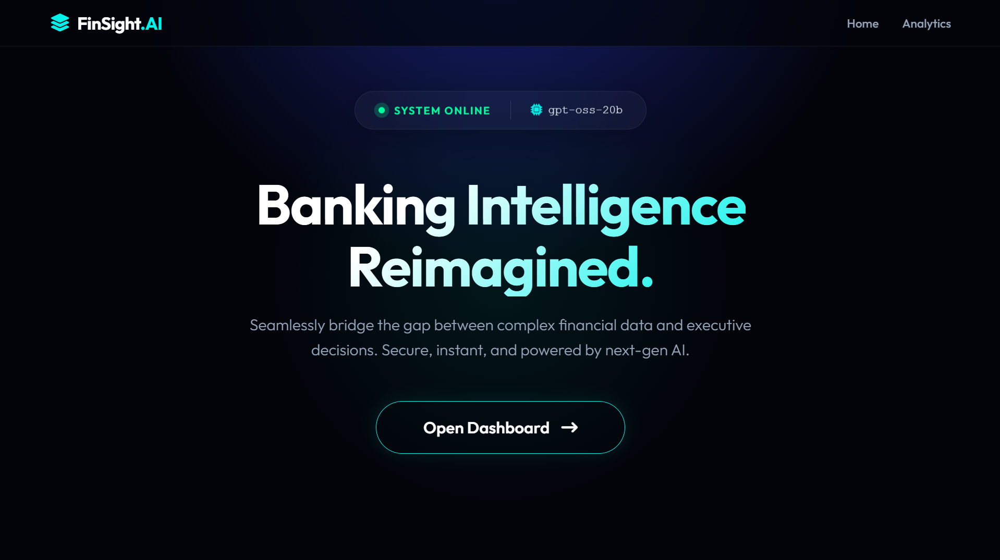
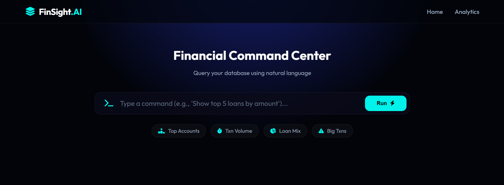
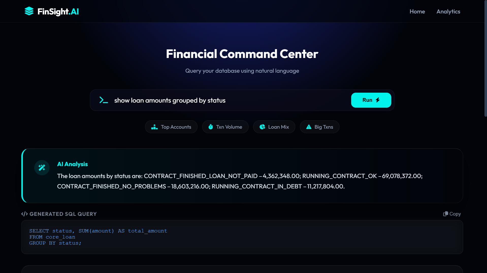
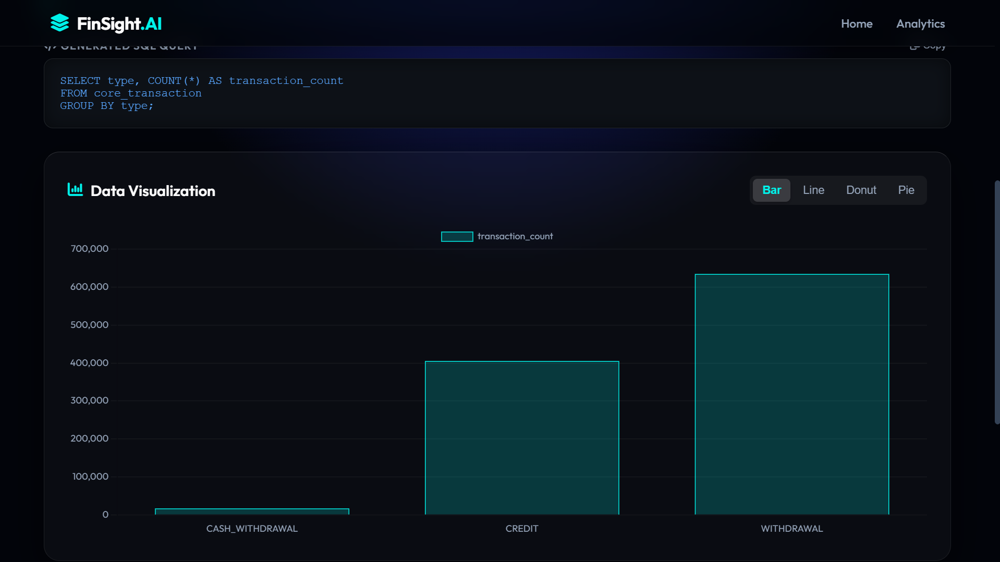
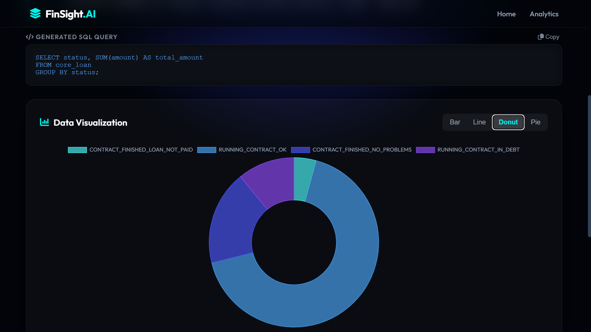

# FinSight AI | Natural-Language Banking Analytics

Ask questions about a bank's data in plain English. FinSight turns each question into SQL with an LLM, checks the query, runs it on PostgreSQL, and shows the answer as an interactive chart, the generated SQL, and a short AI-written summary.



## Features

- **Ask in plain English.** Type "How many accounts were created each year?" and get a table, a chart and a summary.
- **Transparent SQL.** The generated query is always shown (with a copy button), so every answer can be checked.
- **Interactive charts.** Switch between Bar, Line, Donut and Pie views (Chart.js).
- **AI summary.** A second LLM call explains the result in a few sentences.
- **Query safety check.** Queries containing write or schema keywords (`DROP`, `DELETE`, `INSERT`, `UPDATE`, `ALTER`, `TRUNCATE`, `GRANT`) are blocked before they reach the database.
- **Real-sized data.** About 1.05 million transactions, 5,369 clients, 4,500 accounts and 682 loans.

## Screenshots

| Command center | Result with SQL and AI analysis |
|---|---|
|  |  |

| Bar chart | Donut chart |
|---|---|
|  |  |

## How it works

```
Question  ->  Prompt (schema + examples)  ->  LLM (Groq)  ->  SQL
   ->  Safety check  ->  PostgreSQL  ->  Results
   ->  Chart.js chart  +  second LLM call for the summary
```

1. The user's question is sent to the model together with the database schema and a few worked examples (few-shot prompting).
2. The model returns a single SQL query, which is cleaned of any markdown.
3. The query passes a keyword safety check, then runs on PostgreSQL through Django.
4. The rows are drawn as a chart, and the first rows are sent back to the model to write the summary.

## Tech stack

| Layer | Tools |
|---|---|
| Backend | Python, Django 5.2 |
| Database | PostgreSQL |
| LLM | Groq API (tested with `openai/gpt-oss-20b`; set with `GROQ_MODEL`) |
| Frontend | Django templates, custom CSS, Chart.js, Font Awesome |
| Data tools | pandas (data cleaning notebook and loader) |

## Dataset

The data is the public **Berka financial dataset** (a Czech bank, PKDD'99), cleaned in `notebook/cleaning.ipynb`. The CSV files are not stored in this repository because of their size. Download the dataset, run the notebook to produce the cleaned files, and place them in `data/processed/`.

## Setup

**Requirements:** Python 3.10 or newer, PostgreSQL 14 or newer, and a Groq API key (free to create at console.groq.com).

1. **Clone and install**
   ```bash
   git clone https://github.com/riyax11/finsight-ai.git
   cd finsight-ai
   python -m venv venv
   # Windows PowerShell: .\venv\Scripts\Activate.ps1
   # macOS / Linux:      source venv/bin/activate
   pip install -r requirements.txt
   ```

2. **Create a PostgreSQL database** named `finsight`.

3. **Create `config/.env`**
   ```
   DB_NAME=finsight
   DB_USER=postgres
   DB_PASSWORD=your_password
   DB_HOST=localhost
   DB_PORT=5432
   GROQ_API_KEY=your_groq_key
   GROQ_MODEL=openai/gpt-oss-20b
   ```
   Never commit this file. Model access differs between Groq accounts, so check the Groq console for the models available to you.

4. **Create the tables and load the data** (run from the `config` folder)
   ```bash
   cd config
   python manage.py migrate
   python manage.py load_bank_data
   ```

5. **Run**
   ```bash
   python manage.py runserver
   ```
   Open http://127.0.0.1:8000 and click **Open Dashboard**.

## Example questions

- Top 5 accounts by balance
- Count transactions grouped by type
- Show loan amounts grouped by status
- What is the total transaction amount by year?
- Show top 5 clients with the highest loan amounts who are currently in debt

## Project structure

```
config/
  core/            models, views, LLM service, prompts, templates
  core/prompts/    schema and summary prompts
  core/management/ load_bank_data command
  manage.py
data/              raw and cleaned CSV files (not committed)
notebook/          data cleaning notebook
screenshots/       images used in this README
requirements.txt
```

## Known limitations

- **The safety check is a keyword blocklist.** It stops common destructive statements but is not a full guarantee. A stronger design is to run the model's SQL through a **read-only PostgreSQL user**.
- **The AI summary reads only the first 5 rows** of a result, so summaries of longer results can leave rows out.
- **No tests or user login yet**, and the Django `DEBUG` mode and secret key are set for local development only.
- Generated SQL can be wrong for unusual questions, which is why the query is always shown.

## Future work

- Read-only database role, plus a SQL parser instead of keyword matching
- Send aggregated results, not just the first rows, to the summary step
- Automated tests for the SQL safety check and prompts
- User login and saved queries
- Deployment with a hosted PostgreSQL database

## Author

Riya Patkar
